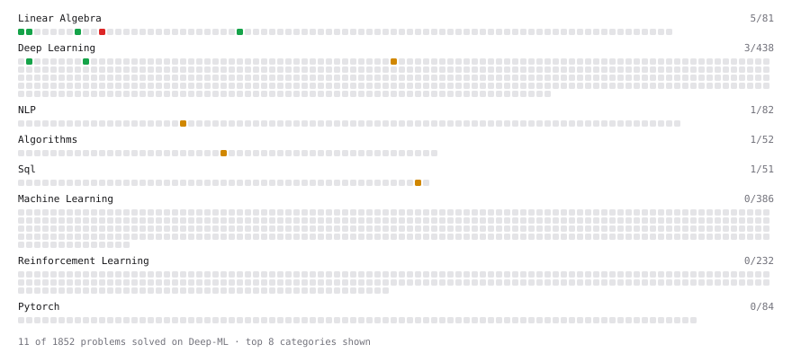

# Deep-ML

My machine learning practice from [Deep-ML](https://www.deep-ml.com). Every solution here was written by hand.

**16** solved · 10 problems · 3 labs · 3 math

[**Browse the interactive portfolio**](https://Utkarshmishra2k2.github.io/deep-ml/) to replay this filling in over time.

## Problems

| | Difficulty | Solved | |
| --- | --- | --- | --- |
| [Dot Product Calculator](https://www.deep-ml.com/problems/83) | easy | 2026-10-28 | [solution](problems/0083-dot-product-calculator) |
| [Implement ReLU Activation Function](https://www.deep-ml.com/problems/42) | easy | 2026-10-06 | [solution](problems/0042-implement-relu-activation-function) |
| [Matrix-Vector Dot Product](https://www.deep-ml.com/problems/1) | easy | 2026-10-28 | [solution](problems/0001-matrix-vector-dot-product) |
| [Softmax Activation Function Implementation ](https://www.deep-ml.com/problems/23) | easy | 2026-10-06 | [solution](problems/0023-softmax-activation-function-implementation) |
| [Transpose of a Matrix](https://www.deep-ml.com/problems/2) | easy | 2026-10-28 | [solution](problems/0002-transpose-of-a-matrix) |
| [Dropout Layer](https://www.deep-ml.com/problems/151) | medium | 2026-09-28 | [solution](problems/0151-dropout-layer) |
| [Merge Intervals and Interval List Intersections](https://www.deep-ml.com/problems/1167) | medium | 2026-10-06 | [solution](problems/1167-merge-intervals-and-interval-list-intersections) |
| [Multi-Token Prediction Training Objective](https://www.deep-ml.com/problems/745) | medium | 2026-09-28 | [solution](problems/0745-multi-token-prediction-training-objective) |
| [Power Users With Purchases in Every Month of the Year](https://www.deep-ml.com/problems/1462) | medium | 2026-10-06 | [solution](problems/1462-power-users-with-purchases-in-every-month-of-the-year) |
| [Singular Value Decomposition (SVD) of 2x2 Matrix](https://www.deep-ml.com/problems/12) | hard | 2026-09-24 | [solution](problems/0012-singular-value-decomposition-svd-of-2x2-matrix) |

## Labs

| | Difficulty | Solved | |
| --- | --- | --- | --- |
| [PyTorch: Build a Complete Training Loop](https://www.deep-ml.com/labs/13) | easy | 2026-09-24 | [solution](labs/0013-pytorch-build-a-complete-training-loop) |
| [Train a Linear Regression Model](https://www.deep-ml.com/labs/18) | easy | 2026-09-28 | [solution](labs/0018-train-a-linear-regression-model) |
| [MNIST: Adversarial Example Generation](https://www.deep-ml.com/labs/5) | hard | 2026-09-29 | [solution](labs/0005-mnist-adversarial-example-generation) |

## Math

| | Difficulty | Solved | |
| --- | --- | --- | --- |
| [Matrix Basics](https://www.deep-ml.com/math-problems/9) | easy | 2026-10-28 | [solution](math/0009-matrix-basics) |
| [Vector Operations](https://www.deep-ml.com/math-problems/7) | easy | 2026-10-28 | [solution](math/0007-vector-operations) |
| [Matrix Multiplication](https://www.deep-ml.com/math-problems/10) | medium | 2026-10-28 | [solution](math/0010-matrix-multiplication) |

---

_This file is regenerated by Deep-ML on every push._
