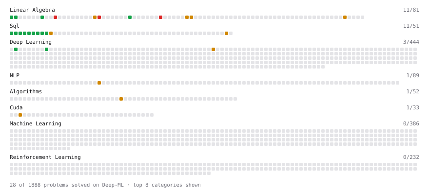

# Deep-ML

My machine learning practice from [Deep-ML](https://www.deep-ml.com). Every solution here was written by hand.

**68** solved · 54 problems · 4 labs · 10 math

[**Browse the interactive portfolio**](https://Utkarshmishra2k2.github.io/deep-ml/) to replay this filling in over time.

## Problems

| | Difficulty | Solved | |
| --- | --- | --- | --- |
| [Average per group](https://www.deep-ml.com/problems/1108) | easy | 2026-11-03 | [solution](problems/1108-average-per-group) |
| [Calculate 2x2 Matrix Inverse](https://www.deep-ml.com/problems/8) | easy | 2026-10-30 | [solution](problems/0008-calculate-2x2-matrix-inverse) |
| [Calculate Cosine Similarity Between Vectors](https://www.deep-ml.com/problems/76) | easy | 2026-11-12 | [solution](problems/0076-calculate-cosine-similarity-between-vectors) |
| [Calculate Mean by Row or Column](https://www.deep-ml.com/problems/4) | easy | 2026-11-09 | [solution](problems/0004-calculate-mean-by-row-or-column) |
| [Compute the Cross Product of Two 3D Vectors](https://www.deep-ml.com/problems/118) | easy | 2026-11-09 | [solution](problems/0118-compute-the-cross-product-of-two-3d-vectors) |
| [Convert Vector to Diagonal Matrix](https://www.deep-ml.com/problems/35) | easy | 2026-11-09 | [solution](problems/0035-convert-vector-to-diagonal-matrix) |
| [Count rows per group](https://www.deep-ml.com/problems/1107) | easy | 2026-11-03 | [solution](problems/1107-count-rows-per-group) |
| [Delete Duplicate Emails Keeping One](https://www.deep-ml.com/problems/1112) | easy | 2026-11-03 | [solution](problems/1112-delete-duplicate-emails-keeping-one) |
| [Dot Product Calculator](https://www.deep-ml.com/problems/83) | easy | 2026-10-28 | [solution](problems/0083-dot-product-calculator) |
| [Filter rows with WHERE](https://www.deep-ml.com/problems/1103) | easy | 2026-11-03 | [solution](problems/1103-filter-rows-with-where) |
| [Handle Missing Data in pandas (dropna/fillna)](https://www.deep-ml.com/problems/1128) | easy | 2026-11-08 | [solution](problems/1128-handle-missing-data-in-pandas-dropna-fillna) |
| [Implement F-Score Calculation for Binary Classification](https://www.deep-ml.com/problems/61) | easy | 2026-11-06 | [solution](problems/0061-implement-f-score-calculation-for-binary-classification) |
| [Implement ReLU Activation Function](https://www.deep-ml.com/problems/42) | easy | 2026-10-06 | [solution](problems/0042-implement-relu-activation-function) |
| [Matrix Determinant & Trace](https://www.deep-ml.com/problems/195) | easy | 2026-11-09 | [solution](problems/0195-matrix-determinant-trace) |
| [Matrix-Vector Dot Product](https://www.deep-ml.com/problems/1) | easy | 2026-10-28 | [solution](problems/0001-matrix-vector-dot-product) |
| [Remove duplicates with DISTINCT](https://www.deep-ml.com/problems/1105) | easy | 2026-11-03 | [solution](problems/1105-remove-duplicates-with-distinct) |
| [Scalar Multiplication of a Matrix](https://www.deep-ml.com/problems/5) | easy | 2026-11-09 | [solution](problems/0005-scalar-multiplication-of-a-matrix) |
| [SELECT all rows](https://www.deep-ml.com/problems/1101) | easy | 2026-11-03 | [solution](problems/1101-select-all-rows) |
| [Select specific columns](https://www.deep-ml.com/problems/1102) | easy | 2026-11-03 | [solution](problems/1102-select-specific-columns) |
| [Softmax Activation Function Implementation ](https://www.deep-ml.com/problems/23) | easy | 2026-10-06 | [solution](problems/0023-softmax-activation-function-implementation) |
| [Sort results with ORDER BY](https://www.deep-ml.com/problems/1104) | easy | 2026-11-03 | [solution](problems/1104-sort-results-with-order-by) |
| [Step-Size Selection for Tile Coding](https://www.deep-ml.com/problems/608) | easy | 2026-11-12 | [solution](problems/0608-step-size-selection-for-tile-coding) |
| [Top N with LIMIT](https://www.deep-ml.com/problems/1106) | easy | 2026-11-03 | [solution](problems/1106-top-n-with-limit) |
| [Transpose of a Matrix](https://www.deep-ml.com/problems/2) | easy | 2026-10-28 | [solution](problems/0002-transpose-of-a-matrix) |
| [Vector Element-wise Sum](https://www.deep-ml.com/problems/121) | easy | 2026-11-06 | [solution](problems/0121-vector-element-wise-sum) |
| [Your first JOIN](https://www.deep-ml.com/problems/1109) | easy | 2026-11-03 | [solution](problems/1109-your-first-join) |
| [Backtracking Search with a Pluggable Deduction Operator](https://www.deep-ml.com/problems/1490) | medium | 2026-11-11 | [solution](problems/1490-backtracking-search-with-a-pluggable-deduction-operator) |
| [Bernoulli Naive Bayes Classifier](https://www.deep-ml.com/problems/140) | medium | 2026-11-09 | [solution](problems/0140-bernoulli-naive-bayes-classifier) |
| [Cholesky Decomposition](https://www.deep-ml.com/problems/334) | medium | 2026-11-02 | [solution](problems/0334-cholesky-decomposition) |
| [Dropout Layer](https://www.deep-ml.com/problems/151) | medium | 2026-09-28 | [solution](problems/0151-dropout-layer) |
| [Employees Earning More Than Their Managers](https://www.deep-ml.com/problems/1113) | medium | 2026-11-03 | [solution](problems/1113-employees-earning-more-than-their-managers) |
| [Filter, Group, and Aggregate a DataFrame (Top-10 by Metric)](https://www.deep-ml.com/problems/1127) | medium | 2026-11-08 | [solution](problems/1127-filter-group-and-aggregate-a-dataframe-top-10-by-metric) |
| [Gaussian Elimination for Solving Linear Systems](https://www.deep-ml.com/problems/58) | medium | 2026-10-30 | [solution](problems/0058-gaussian-elimination-for-solving-linear-systems) |
| [LU Decomposition of a Square Matrix](https://www.deep-ml.com/problems/333) | medium | 2026-10-30 | [solution](problems/0333-lu-decomposition-of-a-square-matrix) |
| [Memory Complexity: Full Space-Time vs. ST-Factorized Attention](https://www.deep-ml.com/problems/725) | medium | 2026-11-11 | [solution](problems/0725-memory-complexity-full-space-time-vs-st-factorized-attention) |
| [Merge Intervals and Interval List Intersections](https://www.deep-ml.com/problems/1167) | medium | 2026-10-06 | [solution](problems/1167-merge-intervals-and-interval-list-intersections) |
| [Month-over-Month Percentage Change with LAG](https://www.deep-ml.com/problems/1115) | medium | 2026-11-11 | [solution](problems/1115-month-over-month-percentage-change-with-lag) |
| [Multi-Token Prediction Training Objective](https://www.deep-ml.com/problems/745) | medium | 2026-09-28 | [solution](problems/0745-multi-token-prediction-training-objective) |
| [New Versus Returning Users per Month](https://www.deep-ml.com/problems/1461) | medium | 2026-11-03 | [solution](problems/1461-new-versus-returning-users-per-month) |
| [Nth-Highest Salary with Ties and NULL](https://www.deep-ml.com/problems/1110) | medium | 2026-11-03 | [solution](problems/1110-nth-highest-salary-with-ties-and-null) |
| [Parallel Reduction (Block Sum) CUDA Kernel](https://www.deep-ml.com/problems/1189) | medium | 2026-11-03 | [solution](problems/1189-parallel-reduction-block-sum-cuda-kernel) |
| [Partitioned Inverse via Schur Complements](https://www.deep-ml.com/problems/1775) | medium | 2026-11-03 | [solution](problems/1775-partitioned-inverse-via-schur-complements) |
| [Power Users With Purchases in Every Month of the Year](https://www.deep-ml.com/problems/1462) | medium | 2026-10-06 | [solution](problems/1462-power-users-with-purchases-in-every-month-of-the-year) |
| [Rank Rows Within Partitions Using Window Functions](https://www.deep-ml.com/problems/1114) | medium | 2026-11-06 | [solution](problems/1114-rank-rows-within-partitions-using-window-functions) |
| [Top-3 Salaries Per Department](https://www.deep-ml.com/problems/1111) | medium | 2026-11-03 | [solution](problems/1111-top-3-salaries-per-department) |
| [Weekly Cohort Retention with a Week-over-Week Drop Flag](https://www.deep-ml.com/problems/1471) | medium | 2026-11-03 | [solution](problems/1471-weekly-cohort-retention-with-a-week-over-week-drop-flag) |
| [Cohort Retention: First Login and Consecutive-Day Logins](https://www.deep-ml.com/problems/1119) | hard | 2026-11-13 | [solution](problems/1119-cohort-retention-first-login-and-consecutive-day-logins) |
| [Implement the Conjugate Gradient Method for Solving Linear Systems](https://www.deep-ml.com/problems/63) | hard | 2026-11-02 | [solution](problems/0063-implement-the-conjugate-gradient-method-for-solving-linear-systems) |
| [Implement the GRPO Objective Function](https://www.deep-ml.com/problems/101) | hard | 2026-11-12 | [solution](problems/0101-implement-the-grpo-objective-function) |
| [Kronecker Products Without Forming Them](https://www.deep-ml.com/problems/1779) | hard | 2026-11-09 | [solution](problems/1779-kronecker-products-without-forming-them) |
| [MoE Run-Health Monitor: Spikes, Loss Alarm, Routing Collapse and Rogue Experts](https://www.deep-ml.com/problems/1990) | hard | 2026-11-09 | [solution](problems/1990-moe-run-health-monitor-spikes-loss-alarm-routing-collapse-and-rogue-experts) |
| [QR Decomposition](https://www.deep-ml.com/problems/201) | hard | 2026-11-02 | [solution](problems/0201-qr-decomposition) |
| [Regex to DFA Token Masks for Structured Output](https://www.deep-ml.com/problems/1641) | hard | 2026-11-06 | [solution](problems/1641-regex-to-dfa-token-masks-for-structured-output) |
| [Singular Value Decomposition (SVD) of 2x2 Matrix](https://www.deep-ml.com/problems/12) | hard | 2026-09-24 | [solution](problems/0012-singular-value-decomposition-svd-of-2x2-matrix) |

## Labs

| | Difficulty | Solved | |
| --- | --- | --- | --- |
| [Design Your Own Activation Function](https://www.deep-ml.com/labs/9) | easy | 2026-11-11 | [solution](labs/0009-design-your-own-activation-function) |
| [PyTorch: Build a Complete Training Loop](https://www.deep-ml.com/labs/13) | easy | 2026-09-24 | [solution](labs/0013-pytorch-build-a-complete-training-loop) |
| [Train a Linear Regression Model](https://www.deep-ml.com/labs/18) | easy | 2026-09-28 | [solution](labs/0018-train-a-linear-regression-model) |
| [MNIST: Adversarial Example Generation](https://www.deep-ml.com/labs/5) | hard | 2026-09-29 | [solution](labs/0005-mnist-adversarial-example-generation) |

## Math

| | Difficulty | Solved | |
| --- | --- | --- | --- |
| [Matrix Basics](https://www.deep-ml.com/math-problems/9) | easy | 2026-10-28 | [solution](math/0009-matrix-basics) |
| [ML Workflow Basics](https://www.deep-ml.com/math-problems/30) | easy | 2026-11-11 | [solution](math/0030-ml-workflow-basics) |
| [Vector Operations](https://www.deep-ml.com/math-problems/7) | easy | 2026-10-28 | [solution](math/0007-vector-operations) |
| [Determinants and Trace](https://www.deep-ml.com/math-problems/11) | medium | 2026-11-06 | [solution](math/0011-determinants-and-trace) |
| [Inverse and Rank](https://www.deep-ml.com/math-problems/12) | medium | 2026-10-30 | [solution](math/0012-inverse-and-rank) |
| [Matrix Multiplication](https://www.deep-ml.com/math-problems/10) | medium | 2026-10-28 | [solution](math/0010-matrix-multiplication) |
| [Orthogonality and Projections](https://www.deep-ml.com/math-problems/14) | medium | 2026-11-02 | [solution](math/0014-orthogonality-and-projections) |
| [Solving Linear Systems](https://www.deep-ml.com/math-problems/13) | medium | 2026-10-30 | [solution](math/0013-solving-linear-systems) |
| [Vector Norms and Linear Independence](https://www.deep-ml.com/math-problems/8) | medium | 2026-11-09 | [solution](math/0008-vector-norms-and-linear-independence) |
| [Matrix Decompositions: LU and QR](https://www.deep-ml.com/math-problems/15) | hard | 2026-10-30 | [solution](math/0015-matrix-decompositions-lu-and-qr) |

---

_This file is regenerated by Deep-ML on every push._
